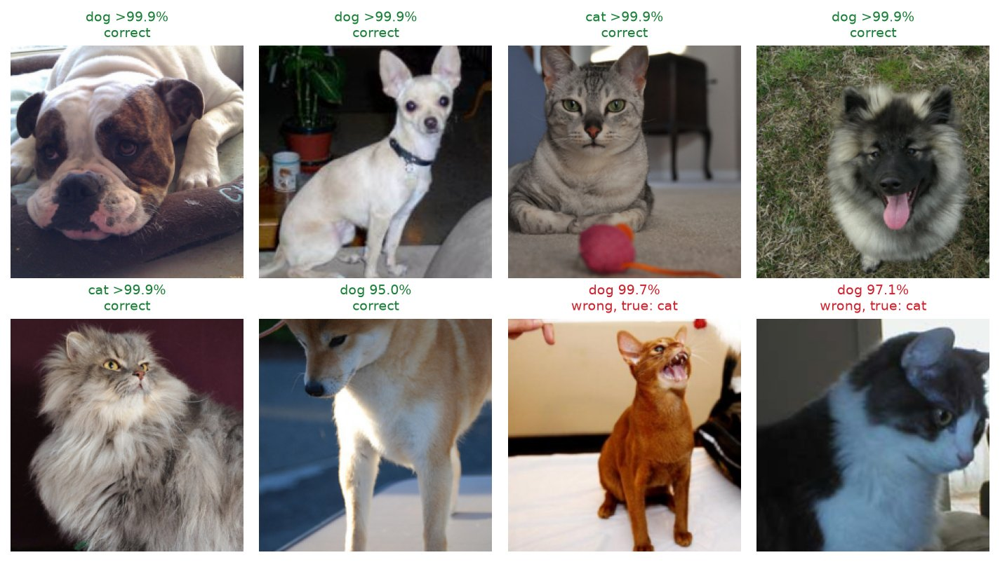
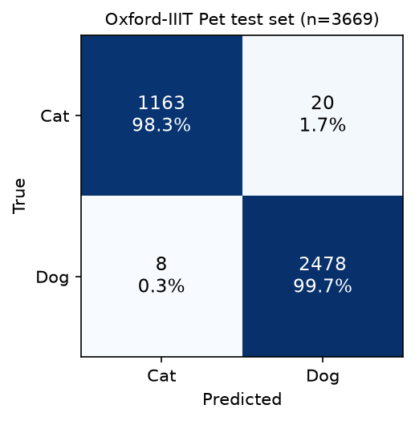

# CNNandDogs

A cat vs dog image classifier in PyTorch. It fine-tunes an ImageNet-pretrained ResNet-18 on the
[Oxford-IIIT Pet](https://www.robots.ox.ac.uk/~vgg/data/pets/) dataset, reaching
**99.2% accuracy** on the 3,669-image held-out test set after about 9 minutes of training on
an Apple M1 laptop. A `catdog predict` command classifies your own photos.



<sub>Test images from Oxford-IIIT Pet: six picked at random and the two mistakes the model was most
confident about.</sub>

## Quick start

Needs [uv](https://docs.astral.sh/uv/) (it installs Python 3.12 if missing). Runs on CPU,
Apple Silicon (MPS) or CUDA, picked automatically. `uv sync` installs PyTorch's regular PyPI
wheels, which include CUDA support on Linux; PyPI's Windows wheels are CPU-only.

```sh
uv sync                    # install pinned dependencies into .venv
uv run catdog download     # fetch Oxford-IIIT Pet into data/ (about 800 MB)
uv run catdog train        # fine-tune, writes checkpoints/catdog-resnet18.pt
uv run catdog evaluate     # test-set metrics and figures, written to docs/
uv run catdog predict path/to/photo.jpg [more.jpg ...]
```

`predict` prints one line per image:

```
$ uv run catdog predict data/oxford-iiit-pet/images/Bengal_192.jpg data/oxford-iiit-pet/images/samoyed_191.jpg
data/oxford-iiit-pet/images/Bengal_192.jpg: cat (>99.9%)
data/oxford-iiit-pet/images/samoyed_191.jpg: dog (>99.9%)
```

Run `uv run catdog <command> --help` for options (`--device`, `--epochs`, `--seed`, and others).
When you are done, `rm -rf data/` frees the disk space; `catdog download` fetches it again.

## Results

Scored once on the official Oxford-IIIT Pet **test** split, which is never used for training or
model selection. Produced by `uv run catdog train && uv run catdog evaluate` (seed 0, defaults)
on an Apple M1 with MPS; the full output is in [`docs/results.json`](docs/results.json).

| Metric | Value |
|---|---|
| Test accuracy | **99.24%** (3,641 of 3,669) |
| Balanced accuracy | 98.99% |
| Cat precision / recall | 99.32% / 98.31% (1,183 images) |
| Dog precision / recall | 99.20% / 99.68% (2,486 images) |
| Errors | 20 cats called dogs, 8 dogs called cats |
| Validation accuracy (368 images, last epoch) | 98.91% |
| Training time (3 epochs, M1, MPS) | 9.2 minutes |



How to read these numbers:

- Cat vs dog is an easy task for an ImageNet-pretrained network. ImageNet already contains many of
  these breeds, so a high score is expected and says as much about the pretrained features as
  about this fine-tune. The interesting part is the small set of errors.
- About a third of the images are cats (12 of the 37 breeds), so balanced accuracy (the mean of
  per-class recall) is reported next to plain accuracy.
- GPU kernels are not bit-for-bit deterministic, so a rerun on other hardware, or on MPS, can move
  the last digit. The seed fixes the data split, the shuffling and the augmentation.

## How it works

- **Data.** Oxford-IIIT Pet has 7,349 photos of 37 cat and dog breeds, labelled with the species,
  which gives the cat/dog label directly. The official `trainval` split (3,680 images) is split
  90/10 with a fixed seed into training and validation sets, and the official `test` split
  (3,669 images) is held out for the final score. Data comes from torchvision's
  `OxfordIIITPet` loader; `catdog download` deletes the archives after extracting them.
- **Model.** torchvision's ResNet-18 with ImageNet weights, its 1000-class head replaced by a
  2-class linear layer. All layers are fine-tuned.
- **Training.** 3 epochs, batch size 32, AdamW (learning rate 3e-4, weight decay 1e-4) with a
  cosine schedule, cross-entropy loss. Training images get a random resized crop (224 px, 60 to
  100% of the area) and a horizontal flip; evaluation uses a resize to 256 px and a 224 px center
  crop. Validation accuracy is printed after each epoch; the final model is saved.

PyTorch and torchvision were chosen because torchvision ships both the dataset loader and the
pretrained backbone, and the same code runs on CPU, Apple MPS and CUDA without changes.

## Development

```sh
uv run pytest            # unit tests, no dataset or GPU needed
uv run ruff check . && uv run ruff format --check .
```

The tests build a tiny fake copy of the dataset on disk with random images and cover the data
pipeline, the model, the metrics, a training run and the CLI. CI
([`.github/workflows/ci.yml`](.github/workflows/ci.yml)) runs lint and tests on every push and
pull request. It installs the `cpu` dependency group (`uv sync --locked --no-dev --group cpu`),
which swaps in the CPU-only PyTorch wheels instead of the multi-GB CUDA build, asserts that the
installed torch is the `+cpu` build, and runs the same ruff and pytest commands with
`UV_NO_SYNC=1` so that `uv run` keeps that environment instead of re-syncing to the default
`dev` group.

```
src/catdog/
  cli.py       catdog download | train | evaluate | predict
  data.py      dataset loading, cat/dog labels, split, transforms
  model.py     ResNet-18 with a 2-class head, checkpoint save/load
  train.py     fine-tuning loop
  evaluate.py  test-set metrics, confusion matrix, example figure
  metrics.py   confusion matrix, accuracy, precision, recall, F1
  predict.py   classify image files
tests/         pytest suite
docs/          results.json and the figures above (written by catdog evaluate)
```

## Data credit

Oxford-IIIT Pet, by O. M. Parkhi, A. Vedaldi, A. Zisserman and C. V. Jawahar,
"Cats and Dogs", IEEE CVPR 2012. The dataset is available under the
[Creative Commons Attribution-ShareAlike 4.0](https://creativecommons.org/licenses/by-sa/4.0/)
license, and the copyright of each image stays with its owner. The example photos in
`docs/examples.jpg` come from it. The dataset is downloaded by
`catdog download` and is not part of this repository.

## History

This repository started in 2019 as the cat vs dog CNN exercise from the Udemy course
"Deep Learning A-Z" by Kirill Eremenko and Hadelin de Ponteves (SuperDataScience): a small Keras
network trained from scratch on 64x64 images. That course code no longer ran on current Keras
and its dataset was not included, so it was replaced by this PyTorch rebuild. The original files
remain in the git history.
